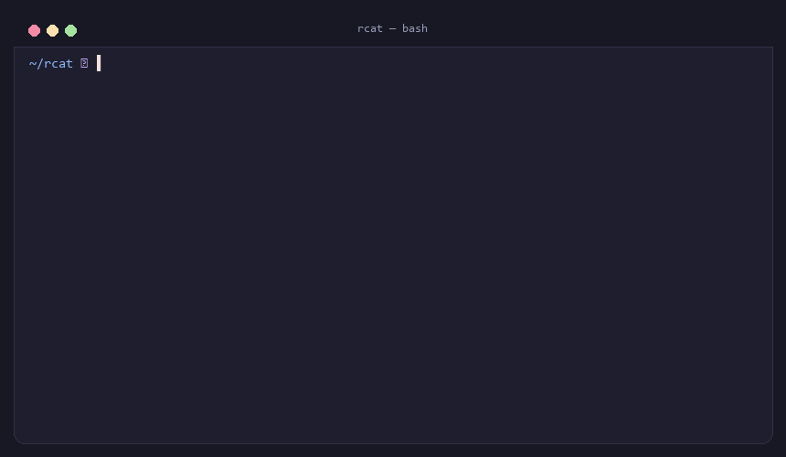

# rcat 🐱✨

<p align="center">
  <strong>A modern, blazingly fast <code>cat</code> alternative written in pure Rust with syntax highlighting, git integration, and hex viewer.</strong>
</p>

<p align="center">
  <a href="https://github.com/adrhmnhkm/rcat/actions/workflows/ci.yml"></a>
  <a href="https://github.com/adrhmnhkm/rcat/releases"></a>
  
  <a href="LICENSE"></a>
  
</p>

<p align="center">
  <a href="#-key-features">Key Features</a> •
  <a href="#-comparison-table">Comparison</a> •
  <a href="#-installation">Installation</a> •
  <a href="#-usage--examples">Usage</a> •
  <a href="#️-configuration-configtoml">Configuration</a> •
  <a href="#-contributing">Contributing</a>
</p>

---

<p align="center">
  
</p>

<p align="center">
  <em>🔥 Live demo: Full Frame style with Git Diffs (<code>~│</code>), Line Range filtering, and colored Hex Dump view!</em>
</p>

---

## ⚡ Comparison Table

| Feature | GNU `cat` | `bat` | `rcat` 🐱 |
|---|:---:|:---:|:---:|
| **Syntax Highlighting** | ❌ | ✅ | ✅ |
| **Git Gutter Diff (`+`, `~`, `-`)** | ❌ | ✅ | ✅ |
| **Terminal Image Preview (`.png`, `.jpg`)** | ❌ | ❌ | ✅ *(truecolor half-blocks)* |
| **Keyword / Regex Highlight (`-H`)** | ❌ | ✅ | ✅ |
| **Copy to Clipboard (`-c`)** | ❌ | ❌ | ✅ *(OSC 52 + Native)* |
| **File Stats & Metadata (`--stats`)** | ❌ | ❌ | ✅ |
| **Binary Protection** | ❌ *(corrupts terminal)* | ✅ | ✅ *(graceful warning)* |
| **Built-in Hex Dump Viewer (`-X`)** | ❌ | ❌ | ✅ *(xxd-like colored hex dump)* |
| **Line Range Selection (`-r`)** | ❌ | ✅ | ✅ |
| **GNU cat Flags (`-n`, `-b`, `-s`, `-E`, `-T`, `-A`)** | ✅ | ⚠️ *(partial)* | ✅ *(100% compatible)* |
| **Pure Rust Engine (No C compiler / CMake needed)** | ❌ | ❌ *(libgit2/onig C)* | ✅ *(pure Rust)* |
| **User Configuration (`config.toml`)** | ❌ | ✅ | ✅ |

---

## ✨ Key Features

- 🎨 **Automatic Syntax Highlighting**: Detects language automatically via file extensions or shebang headers (`#!/bin/...`).
- 🖼️ **Terminal Image Preview**: Renders `.png`, `.jpg`, `.jpeg`, `.webp`, `.bmp` directly in the terminal using 24-bit RGB and Unicode half-blocks (`▀`).
- 🔍 **Keyword & Regex Highlighting (`-H, --highlight`)**: Prominently highlights matching search terms without breaking underlying syntax highlighting.
- 📋 **Copy to Clipboard (`-c, --copy`)**: Automatically copies the displayed output to your system clipboard (universal OSC 52 + native fallback).
- 📊 **File Statistics & Metadata (`--stats`)**: Shows detailed line count, word count, character count, and detected language in a sleek footer.
- 🌿 **Git Integration**: Live gutter indicators for newly added (`+`), modified (`~`), or removed (`-`) lines directly against your git repository.
- 🛡️ **Binary File Protection**: Prevents accidental terminal corruption by checking for binary content before printing.
- 🔬 **Interactive Hex Dump Mode (`-X, --hex`)**: Inspect binaries or files with a colored 3-column hex viewer (Offset, Hex Bytes, ASCII).
- 📋 **GNU `cat` Compatibility**: Full support for `-n` (number), `-b` (number-nonblank), `-s` (squeeze-blank), `-E` (show-ends), `-T` (show-tabs), and `-A` (show-all).
- ⚙️ **Persistent User Configuration (`config.toml`)**: Set your preferred themes and styles once and enjoy them everywhere.
- 🚀 **Zero C Dependencies**: Built with pure Rust dependencies for maximum cross-platform portability across Windows, Linux, and macOS.

---

## 📦 Installation

### Pre-compiled Binaries (GitHub Releases)
Download ready-to-use binaries for Windows (`.zip`), Linux (`.tar.gz`), and macOS (`.tar.gz`) directly from the [Releases](https://github.com/adrhmnhkm/rcat/releases) page.

### From Source (using Cargo)
```bash
git clone https://github.com/adrhmnhkm/rcat.git
cd rcat
cargo build --release
```
The compiled binary will be placed at `target/release/rcat` (or `rcat.exe` on Windows).

---

## 💻 Usage & Examples

### 1. Highlight file with line numbers and git gutter
```bash
rcat -n src/main.rs
```

### 2. Full frame style (header + border + git diffs)
```bash
rcat --style full Cargo.toml
```

### 3. Display line range (e.g. lines 10 to 30)
```bash
rcat -r 10:30 src/main.rs

# From line 20 to EOF
rcat -r 20: src/main.rs
```

### 4. Highlight specific keywords or regex pattern
```bash
rcat -H "TODO" src/main.rs
rcat -H "process_[a-z]+" src/main.rs
```

### 5. Render image directly in terminal
```bash
rcat assets/showcase.png
```

### 6. Copy output directly to clipboard
```bash
rcat -r 1:25 src/main.rs -c
```

### 7. Display file metadata & statistics
```bash
rcat --stats Cargo.toml
```

### 8. Inspect binary file as Hex Dump
```bash
rcat -X binary_file.exe
```

### 9. Standard GNU `cat` behavior (Squeeze blanks & show ends)
```bash
rcat -s -A file.txt
```

### 10. Read from stdin with manual syntax override
```bash
curl -s https://api.github.com | rcat -l json
```

### 11. Choose from dozens of themes
```bash
rcat --list-themes
rcat --theme "Solarized (dark)" src/main.rs
```

---

## ⚙️ Configuration (`config.toml`)

Create a `config.toml` file to persist your favorite settings without typing CLI flags every time:

- **Windows**: `%APPDATA%\rcat\config.toml`
- **Linux & macOS**: `~/.config/rcat/config.toml`

```toml
# Default theme (see `rcat --list-themes`)
theme = "base16-ocean.dark"

# Default style: "plain", "numbers", "grid", "header", "full"
style = "grid"

# Default behaviors
number = false
squeeze_blank = false
show_ends = false
show_tabs = false
```

You can also pass a custom config file:
```bash
rcat --config ./my_config.toml main.rs
rcat --no-config main.rs
```

---

## 🛠️ Command-Line Flags

| Flag | Description |
|---|---|
| `-n, --number` | Number all output lines with gutter grid |
| `-b, --number-nonblank` | Number non-empty output lines only |
| `-s, --squeeze-blank` | Squeeze repeated blank lines into a single blank line |
| `-E, --show-ends` | Display `$` at the end of each line |
| `-T, --show-tabs` | Display TAB characters as `^I` |
| `-A, --show-all` | Equivalent to `-ET` |
| `-r, --line-range <M:N>` | Only print lines in range (`10:25`, `:50`, `15:`, `42`) |
| `-l, --language <LANG>` | Force syntax language manually (e.g. `rust`, `python`) |
| `-H, --highlight <PAT>` | Highlight keywords or regex patterns in output |
| `-c, --copy` | Copy displayed output directly to system clipboard |
| `--stats` | Display file metadata & statistics in footer |
| `--image` | Force rendering input file as an image |
| `-X, --hex` | Display content in colored Hex Dump format |
| `-f, --force` | Force printing raw text even if binary data is detected |
| `--style <MODE>` | Style preset: `plain`, `numbers`, `grid`, `header`, `full` |
| `--theme <NAME>` | Set syntax highlighting theme |
| `--list-themes` | List all available syntax themes |
| `--list-languages` | List all supported programming languages |
| `--git / --no-git` | Toggle Git diff indicators |
| `--config <PATH>` | Load custom TOML configuration file |
| `--no-config` | Disable loading user configuration |

---

## 🌟 Star History

<p align="center">
  <a href="https://star-history.com/#adrhmnhkm/rcat&Date">
    
  </a>
</p>

---

## 🤝 Contributing

Contributions, issues, and feature requests are welcome!
Feel free to check the [issues page](https://github.com/adrhmnhkm/rcat/issues).

1. Fork the Project
2. Create your Feature Branch (`git checkout -b feature/AmazingFeature`)
3. Commit your Changes (`git commit -m 'Add some AmazingFeature'`)
4. Push to the Branch (`git push origin feature/AmazingFeature`)
5. Open a Pull Request

---

## 📄 License

Distributed under the **MIT License**. See [`LICENSE`](LICENSE) for more information.
